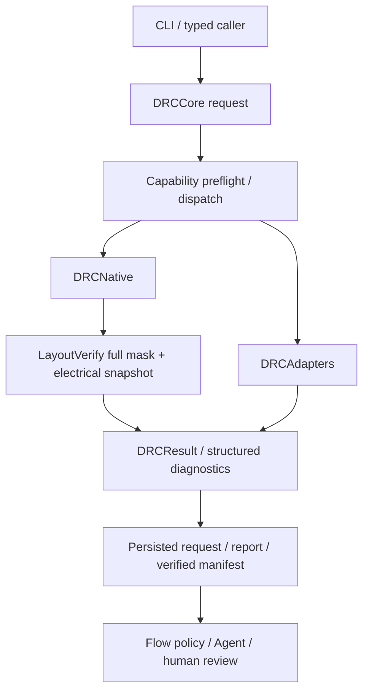

# DRCEngine Design Contract

## Purpose and Scope
DRCEngine is the independent DRC package in the [LSI system](../DESIGN.md).
It evaluates native physical and antenna rules or records an explicitly selected
external tool's observations. The affected module authorities are the direct
children indexed below; existing foundry-import, parser and persistence paths
retain their package contracts.

## Responsibilities and Boundaries
DRCEngine owns typed requests, backend admission, native/external execution,
raw diagnostics, waivers and verifiable result artifacts. Layout geometry and
device recognition remain semiconductor-layout responsibilities. ToolQualification
and the composing flow policy decide tool trust and signoff eligibility.
Xcircuite and DesignFlowKernel own project, candidate and approval lifecycle.

## Related Designs
| Design | Relationship | Contract Used | Summary | Cautions |
|---|---|---|---|---|
| [LSI](../DESIGN.md) | parent | Standalone signoff composition | Package context | Native correctness does not imply production qualification |
| [DRCCore](Sources/DRCCore/DESIGN.md) | child | Requests and backend admission | Shared typed contract | New wire fields are required |
| [DRCNative](Sources/DRCNative/DESIGN.md) | child | Standard-mask and rectangle-layout execution | Native primary backend | Input formats have distinct capabilities |
| [DRCAdapters](Sources/DRCAdapters/DESIGN.md) | child | External execution and explicit refusal | Optional external observations | Unsupported semantics cannot be ignored |
| [DRCRuntime](Sources/DRCRuntime/DESIGN.md) | child | Dispatch and retained request truth | Execution composition | Retained context must match actual dispatch |
| [DRCCLICore](Sources/DRCCLICore/DESIGN.md) | child | Typed command intake | Developer and Agent operation | Invalid input refuses before execution |
| [LayoutVerify](../semiconductor-layout/Sources/LayoutVerify/DESIGN.md) | depends on | Exact physical geometry and prepared electrical snapshot | Native rule owner | Electrical interpretation does not replace the full mask |
| [CircuiteFoundation](../CircuiteFoundation/DESIGN.md) | depends on | Engine, artifact and provenance vocabulary | Cross-package floor | A URL alone is not attested evidence |
| [Xcircuite](../Xcircuite/DESIGN.md) | used by | Candidate-bound signoff execution | Flow composition | Exact source and request artifacts must be retained |

## Architecture

## Contracts and Invariants
The [ElectricalContext authority](Sources/DRCCore/ElectricalContext/DESIGN.md)
owns profile values and admission. Callers select their intended electrical
semantics explicitly; backends declare support and retain the dispatched request.
Physical geometry, technology and rule thresholds remain the original inputs.
A clean verdict requires evaluation under the requested contract; missing capability,
unsupported preparation and real physical shorts remain explicit failures.

`DRCExecuting` refines `CircuiteFoundation.Engine` with DRC request/result types.
`DefaultDRCEngine.execute` is the protocol entry point; `run` supplies DRC-specific
cancellation and timeout controls. `DRCRequest.designObjectReference()` preserves
the top-cell identity. Result URLs become ArtifactReferences only after digest
and byte-count attestation. Existing request commitment includes all options.

An ARC kernel is not foundry-rule validation. Missing required antenna rules or
external qualification evidence remains blocked. Existing geometric corpus
requests keep their declared authority; this change adds no corpus profile override.

## Runtime Flows
Typed input is validated and admitted against the chosen backend before capture
or backend I/O. Native standard-layout execution composes the lower physical and
electrical contracts. Runtime checks result/request identity before persistence;
artifact consumers verify bytes and request commitments before using evidence.

## State, Ownership, and Lifecycle
Profile and capability are immutable values. Backend/runtime owners retain their
existing per-run resources, cancellation, shutdown and artifact lifetimes. The
context change introduces no shared mutable state or target-specific isolation.

## Failure, Concurrency, and Constraints
Unsupported capability, invalid wire values, device preparation refusal and
retained-profile mismatch remain typed failures or existing blocking diagnostics.
Source bytes and artifacts use existing bounded capture and execution policies.
No decoder fallback, label-based inference or silent profile substitution is used.

## Verification and Change Impact
Core and Runtime tests own codec, admission and retained-request truth. Native
tests execute the same standard mask under paired contexts, preserve a real metal
bypass short and refuse unsupported device preparation. CLI tests execute actual
commands and verify persisted options/request digests and before-I/O refusal.
The [same-candidate owner](../Xcircuite/Tests/PhysicalInverterPhysicalCandidateFlowTests/DESIGN.md)
executes the original 92 PATH mask through all five feedback stages and subsequent
human review, CAS and retention/collection. These are native CPU proofs; they do
not establish foundry/process/corner, distributed-RC, Metal, WASM or Embedded qualification.
